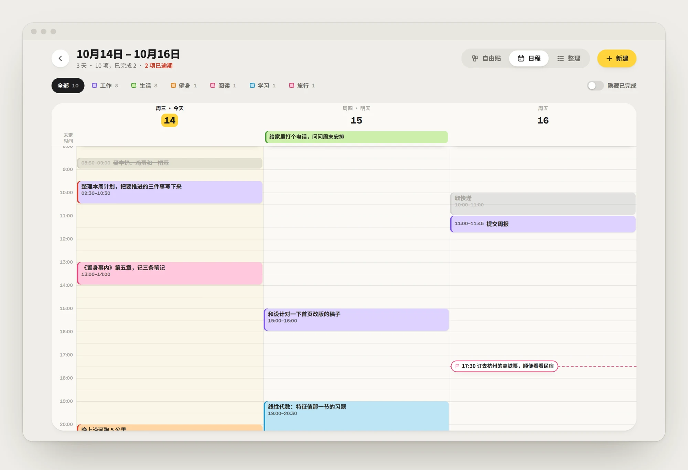

<div align="center">


# Todos 便利贴

把待办贴在日历上。选一天或几天，打开一面可以随手摆放的便利贴墙。

[快速开始](#快速开始) · [部署到 Cloudflare Workers](#部署到-cloudflare-workers) · [部署到自己的服务器](#部署到自己的服务器) · [数据同步](#数据同步)

</div>

<picture>
  <source media="(prefers-color-scheme: dark)" srcset="docs/screenshots/hero-dark.webp">
  
</picture>

<br>

<table>
  <tr>
    <td width="33%" valign="top"><b>零依赖</b><br>服务端只用 Node 内置模块，不需要 <code>npm install</code>，也没有构建步骤。</td>
    <td width="33%" valign="top"><b>多设备同步</b><br>数据存在 SQLite 里，电脑、手机、不同浏览器看到的是同一份。</td>
    <td width="33%" valign="top"><b>离线可用</b><br>断网照常增删改，改动暂存本机，联网后自动补发。</td>
  </tr>
  <tr>
    <td valign="top"><b>为手指设计</b><br>长按拿起便利贴、长按多选日期、左右滑动翻月，底部抽屉式编辑。</td>
    <td valign="top"><b>可选密码</b><br>设置一个环境变量就需要登录，会话 30 天，输错多次自动限流。</td>
    <td valign="top"><b>两种部署方式</b><br>部署到 Cloudflare Workers（数据在 D1），或用 <code>docker compose up -d</code> 跑在自己的服务器上。</td>
  </tr>
</table>

## 用起来是什么样

### 日历

每一天是一张独立的卡片，当天的待办以迷你便利贴的样子贴在上面，按标签着色，有开始时间的会标出时间并排在前面。今天是黑色卡片，选中的日子会被荧光黄划过。左侧是本月进度（每项待办一个小方块，完成后填色）和接下来要做的事。

- 单击一天打开当天；按住拖过几天，松手后一起打开
- <kbd>Ctrl</kbd> / <kbd>⌘</kbd> + 点击跨月累加，<kbd>Shift</kbd> + 点击选一段

### 自由贴

打开选中的日子，便利贴铺在一张点阵白板上：拖到哪里就停在哪里，位置会记住（桌面和手机各记一套）。双击空白处，就在那个位置贴一张新的。完成的便利贴会盖上“已完成”的章；乱了就点“一键排齐”。


### 日程

像 Google 日历那样的时间轴：选中的每一天一列，纵向是 0–24 点。有开始时间的任务画成色块，只有截止时刻的标一面小旗，都没有的放在顶部“未定时间”。

- 在空白处拖一下就新建一段时间；拖动色块改时间或换到另一天，拖底边改时长
- 把“未定时间”里的条目拖进时间轴就排上时间，拖回去就取消
- 同一时段重叠的任务并排显示；今天那一列有一条“现在”的红线
- 键盘：方向键上下挪 15 分钟（加 <kbd>Shift</kbd> 一小时），左右换天，回车编辑



### 时间只填一部分

开始、结束、截止的每一格都可以空着，空着的部分按“这一天”补齐，灰色的占位数字就是补齐后的值，下面实时显示最终结果：

| 这一天是 10 月 14 日，截止填 | 结果 |
| --- | --- |
| 18 时 | 10 月 14 日 18:00 |
| 15 日 18 时 | 10 月 15 日 18:00 |
| 15 日 | 10 月 15 日当天截止（不限时刻） |
| 11 月 1 日 | 11 月 1 日当天截止 |

同时给几天新建时，年月日空着的话，每张各自按自己那天补齐；以后改了日期，“同一天截止”的也会跟着走。

### 整理

同样的内容换成清单，可以按日期、按标签或者一张总列表来看。每组都能直接添加，会自动预选那一天或填好那个标签。

<table>
  <tr>
    <td width="50%"></td>
    <td width="50%"></td>
  </tr>
  <tr>
    <td align="center">按日期</td>
    <td align="center">按标签</td>
  </tr>
</table>

### 手机上


页面上下滑动照常滚动，不会误触：轻点打开，长按才进入拖动或多选。左右滑动月历切换月份。新建和编辑从底部升起，按钮放在拇指够得着的地方。也可以“添加到主屏幕”，像应用一样打开。

### 深色模式与动画

跟随系统自动切换深色模式。切换视图时内容顺着方向滑入，日历和便利贴页之间整页过渡；系统开启“减少动态效果”时全部关闭。随时按 <kbd>Esc</kbd>：关弹窗、取消拖动，或者回到日历。


## 快速开始

需要 Node.js 22.13 或更高版本。

```bash
git clone https://github.com/VenLac/todos.git
cd todos
npm start                          # 打开 http://localhost:8080
```

```bash
TODOS_PASSWORD=你的密码 npm start   # 带密码保护
npm run dev                        # 改了 server/ 下的代码自动重启
npm test                           # 接口测试：同一套用例分别跑 Node 版和 Worker 版
```

不想启动服务也可以直接双击 `public/index.html`，这时数据只存在当前浏览器里，不会同步。

## 部署到 Cloudflare Workers

页面由 Workers 静态资源托管，接口跑在 Worker 里，数据存在 D1（Cloudflare 的 SQLite）。个人使用一般在免费额度内。

```bash
npx wrangler@4.144.0 login                          # 第一次用需要登录 Cloudflare
npm run cf:deploy                                   # 部署；首次会自动创建 D1 数据库
npx wrangler@4.144.0 secret put TODOS_PASSWORD      # 设置访问密码
```

- 首次部署会在你的账号里创建名为 `todos` 的 D1 数据库并和 Worker 关联，之后的部署自动沿用，`wrangler.jsonc` 里不需要填 `database_id`
- 表在第一次请求时自动创建，不需要单独跑迁移
- **没设置密码之前，Worker 是锁着的**：页面会提示你先运行上面第三条命令，接口一律拒绝。确实想不设密码公开访问，可以加一个变量 `ALLOW_OPEN=1`
- 绑定自己的域名：在 Cloudflare 控制台的 Worker 设置里添加自定义域名

本地预览 Worker 版：

```bash
echo 'TODOS_PASSWORD=本地密码' > .dev.vars
npm run cf:dev                                      # 使用本地 D1，不影响线上数据
```

## 部署到自己的服务器

用 Docker Compose：

```bash
cp .env.example .env     # 至少设置 TODOS_PASSWORD
docker compose up -d --build
```

数据在名为 `todos-data` 的数据卷里。升级时 `git pull && docker compose up -d --build`，数据不受影响。

<details>
<summary>只用 Docker</summary>

```bash
docker build -t todos .
docker run -d --name todos -p 8080:8080 \
  -e TODOS_PASSWORD=你的密码 \
  -v todos-data:/data \
  --restart unless-stopped todos
```

</details>

<details>
<summary>直接用 Node 运行（systemd / pm2）</summary>

```bash
PORT=8080 DATA_DIR=/var/lib/todos TODOS_PASSWORD=你的密码 \
  node --disable-warning=ExperimentalWarning server/server.js
```

</details>

<details>
<summary>反向代理与 HTTPS</summary>

公网部署请放在 Caddy / Nginx 后面启用 HTTPS，并设置 `TRUST_PROXY=1`。Caddy 示例：

```
todos.example.com {
  reverse_proxy 127.0.0.1:8080
}
```

页面和接口都用相对路径，挂在子路径下（如 `example.com/todos/`）也能用，代理时去掉前缀即可。

</details>

## 配置

| 变量 | 适用 | 默认值 | 说明 |
| --- | --- | --- | --- |
| `TODOS_PASSWORD` | 两者 | 空 | 访问密码。Node 版不设则任何人都能读写；Workers 版不设则锁住。Workers 上请用 `wrangler secret put` 设置 |
| `SESSION_SECRET` | 两者 | 自动生成 | 会话签名密钥；不设则首次启动时生成并存进数据库 |
| `COOKIE_SECURE` | 两者 | 自动 | 强制开关 Cookie 的 `Secure` 标记；默认按是否 HTTPS 判断 |
| `ALLOW_OPEN` | Workers | 空 | 设为 `1` 时，不设密码也允许访问 |
| `PORT` | Node | `8080` | 监听端口 |
| `HOST` | Node | `0.0.0.0` | 监听地址 |
| `DATA_DIR` | Node | `./data` | 数据目录，数据库是其中的 `todos.db` |
| `TRUST_PROXY` | Node | `0` | 在反向代理后面时设为 `1`，用 `X-Forwarded-For` 识别客户端 IP |

修改密码后所有旧会话立即失效；同一 IP 10 分钟内输错 10 次会被暂时拒绝。

## 备份与恢复

- **导出**：日历页左下角“导出备份”，或请求 `GET /api/export`，得到一个 JSON 文件
- **整库热备份**：数据库开启了 WAL，请用 SQLite 自带的方式复制：

  ```bash
  docker compose exec todos node -e "new (require('node:sqlite').DatabaseSync)('/data/todos.db').exec(\"VACUUM INTO '/data/backup.db'\")"
  ```

- **恢复**：停掉服务，把备份文件放回数据目录并命名为 `todos.db`，再启动
- **Workers 版**：除了“导出备份”，也可以导出整个 D1 数据库：`npx wrangler@4.144.0 d1 export todos --remote --output backup.sql`

## 数据同步

前端的每个操作都先在本机生效，页面立刻响应；然后进入“待同步”队列，在后台批量发给服务器。

- 队列存在 localStorage 里，刷新、关闭页面、断网都不会丢；联网后自动补发
- 打开页面、切回页面、网络恢复时，从服务器拉取最新数据，再叠加本机还没同步的改动
- 每条便利贴带一个 `updatedAt` 时间戳，服务器对同一条**以更新的为准**
- 删除记为“墓碑”，另一台设备上的旧版本不会把删掉的条目写回来；撤销删除会产生更新的版本，可以正常恢复
- 某个浏览器第一次连上服务器时，会把它以前只存在本机的数据合并进去
- Service Worker 采用网络优先：联网时总是最新版本，断网时用缓存打开页面

## 项目结构

```
public/                  前端：纯静态文件，无构建（两种部署共用）
  index.html             日历
  board.html             便利贴：自由贴 / 整理
  login.html             登录
  css/style.css
  js/store.js            数据层：本机缓存、待同步队列、与服务器同步
  js/calendar.js         日历交互
  js/board.js            便利贴交互
  js/login.js
  sw.js                  Service Worker
  manifest.webmanifest   PWA
server/
  api.js                 接口路由与数据校验（Web 标准 Request/Response，两边共用）
  auth.js                密码登录与会话（Web Crypto，两边共用）
  schema.js              表结构与 SQL（两边共用）
  server.js              Node 入口：环境变量、启动、优雅退出
  app.js                 Node：静态文件，把请求转给 api.js
  sqlite.js              Node：node:sqlite 数据层
  worker.js              Workers 入口
  d1.js                  Workers：D1 数据层
test/                    接口测试；D1 用 node:sqlite 模拟，Worker 版不联网也能测
wrangler.jsonc           Workers 配置
Dockerfile · docker-compose.yml · .env.example
docs/screenshots/        README 里的截图
```

## 接口

| 方法 | 路径 | 说明 |
| --- | --- | --- |
| `GET` | `/api/health` | 健康检查 |
| `GET` | `/api/session` | `{ auth, ok, setup }`：是否需要登录、是否已登录、是否还没设置密码 |
| `POST` | `/api/login` | `{ password }` |
| `POST` | `/api/logout` | 退出登录 |
| `GET` | `/api/todos` | `{ todos, rev, fresh }` |
| `POST` | `/api/sync` | `{ upsert: [条目], remove: [{ id, updatedAt }] }` |
| `GET` | `/api/export` | 下载全部数据 |

写接口只接受 `Content-Type: application/json`，配合 `SameSite=Lax` 的会话 Cookie 防止跨站提交；所有写入的数据都会校验，坏数据整批拒收。
