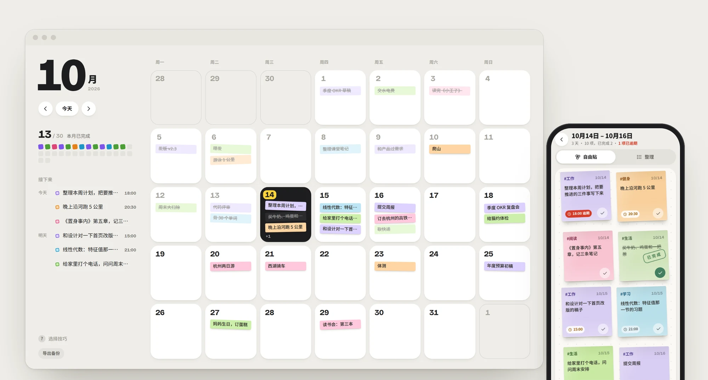
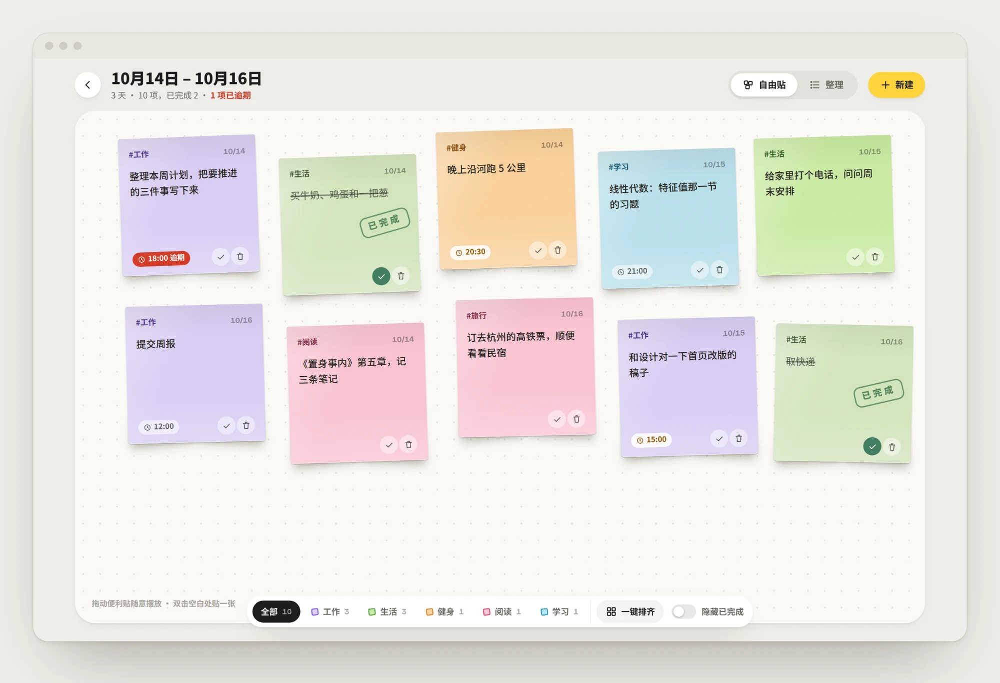
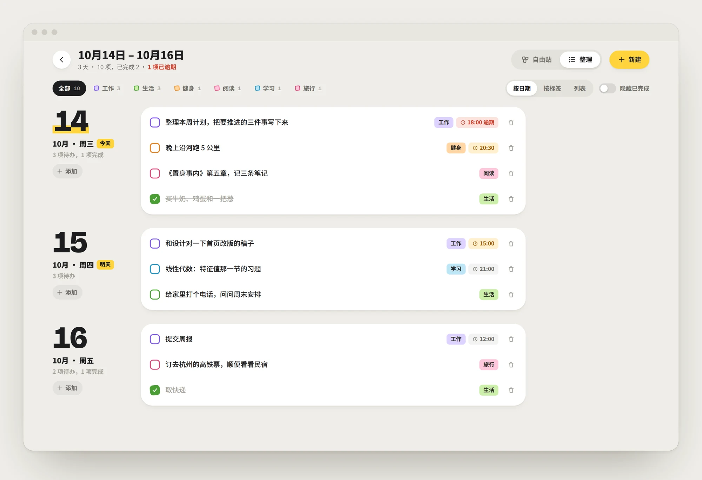
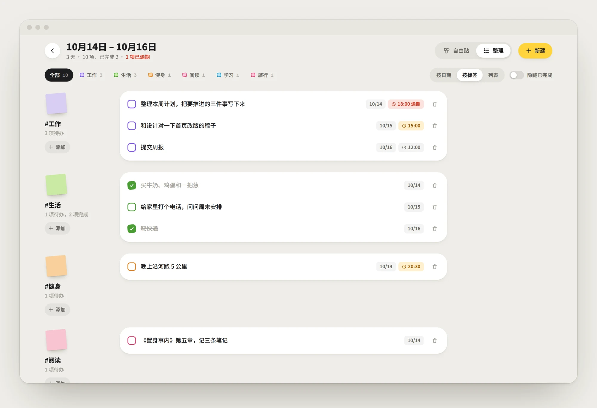
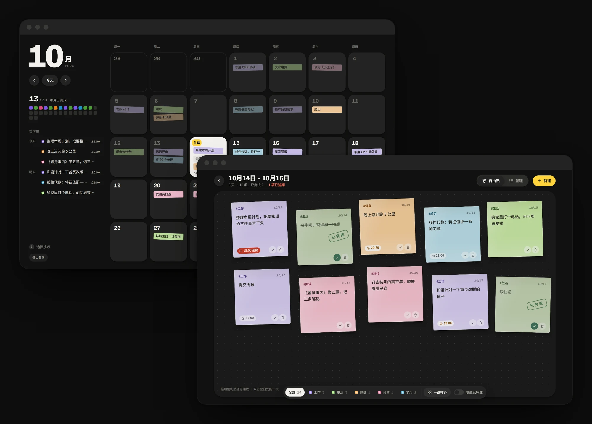

<div align="center">


# Todos 便利贴

把待办贴在日历上。选一天或几天，打开一面可以随手摆放的便利贴墙。

[快速开始](#快速开始) · [部署](#部署) · [数据同步](#数据同步) · [接口](#接口)

</div>

<picture>
  <source media="(prefers-color-scheme: dark)" srcset="docs/screenshots/hero-dark.webp">
  
</picture>

<br>

<table>
  <tr>
    <td width="33%" valign="top"><b>零依赖</b><br>服务端只用 Node 内置模块，不需要 <code>npm install</code>，也没有构建步骤。</td>
    <td width="33%" valign="top"><b>多设备同步</b><br>数据存在 SQLite 里，电脑、手机、不同浏览器看到的是同一份。</td>
    <td width="33%" valign="top"><b>离线可用</b><br>断网照常增删改，改动暂存本机，联网后自动补发。</td>
  </tr>
  <tr>
    <td valign="top"><b>为手指设计</b><br>长按拿起便利贴、长按多选日期、左右滑动翻月，底部抽屉式编辑。</td>
    <td valign="top"><b>可选密码</b><br>设置一个环境变量就需要登录，会话 30 天，输错多次自动限流。</td>
    <td valign="top"><b>一条命令部署</b><br><code>docker compose up -d</code>，数据放在数据卷里，升级不丢。</td>
  </tr>
</table>

## 用起来是什么样

### 日历

每一天是一张独立的卡片，当天的待办以迷你便利贴的样子贴在上面，按标签着色。今天是黑色卡片，选中的日子会被荧光黄划过。左侧是本月进度（每项待办一个小方块，完成后填色）和接下来要做的事。

- 单击一天打开当天；按住拖过几天，松手后一起打开
- <kbd>Ctrl</kbd> / <kbd>⌘</kbd> + 点击跨月累加，<kbd>Shift</kbd> + 点击选一段

### 自由贴

打开选中的日子，便利贴铺在一张点阵白板上：拖到哪里就停在哪里，位置会记住（桌面和手机各记一套）。双击空白处，就在那个位置贴一张新的。完成的便利贴会盖上“已完成”的章；乱了就点“一键排齐”。



### 整理

同样的内容换成清单，可以按日期、按标签或者一张总列表来看。每组都能直接添加，会自动预选那一天或填好那个标签。

<table>
  <tr>
    <td width="50%"></td>
    <td width="50%"></td>
  </tr>
  <tr>
    <td align="center">按日期</td>
    <td align="center">按标签</td>
  </tr>
</table>

### 手机上


页面上下滑动照常滚动，不会误触：轻点打开，长按才进入拖动或多选。左右滑动月历切换月份。新建和编辑从底部升起，按钮放在拇指够得着的地方。也可以“添加到主屏幕”，像应用一样打开。

### 深色模式

跟随系统自动切换。



## 快速开始

需要 Node.js 22.13 或更高版本。

```bash
git clone https://github.com/VenLac/todos.git
cd todos
npm start                          # 打开 http://localhost:8080
```

```bash
TODOS_PASSWORD=你的密码 npm start   # 带密码保护
npm run dev                        # 改了 server/ 下的代码自动重启
npm test                           # 跑接口测试
```

不想启动服务也可以直接双击 `public/index.html`，这时数据只存在当前浏览器里，不会同步。

## 部署

推荐用 Docker Compose：

```bash
cp .env.example .env     # 至少设置 TODOS_PASSWORD
docker compose up -d --build
```

数据在名为 `todos-data` 的数据卷里。升级时 `git pull && docker compose up -d --build`，数据不受影响。

<details>
<summary>只用 Docker</summary>

```bash
docker build -t todos .
docker run -d --name todos -p 8080:8080 \
  -e TODOS_PASSWORD=你的密码 \
  -v todos-data:/data \
  --restart unless-stopped todos
```

</details>

<details>
<summary>直接用 Node 运行（systemd / pm2）</summary>

```bash
PORT=8080 DATA_DIR=/var/lib/todos TODOS_PASSWORD=你的密码 \
  node --disable-warning=ExperimentalWarning server/server.js
```

</details>

<details>
<summary>反向代理与 HTTPS</summary>

公网部署请放在 Caddy / Nginx 后面启用 HTTPS，并设置 `TRUST_PROXY=1`。Caddy 示例：

```
todos.example.com {
  reverse_proxy 127.0.0.1:8080
}
```

页面和接口都用相对路径，挂在子路径下（如 `example.com/todos/`）也能用，代理时去掉前缀即可。

</details>

### 配置

| 变量 | 默认值 | 说明 |
| --- | --- | --- |
| `TODOS_PASSWORD` | 空 | 访问密码。**不设则任何能访问这个地址的人都能读写** |
| `PORT` | `8080` | 监听端口 |
| `HOST` | `0.0.0.0` | 监听地址 |
| `DATA_DIR` | `./data` | 数据目录，数据库是其中的 `todos.db` |
| `TRUST_PROXY` | `0` | 在反向代理后面时设为 `1`，用 `X-Forwarded-For` 识别客户端 IP |
| `SESSION_SECRET` | 自动生成 | 会话签名密钥；不设则首次启动生成并存进数据库 |
| `COOKIE_SECURE` | 自动 | 强制开关 Cookie 的 `Secure` 标记 |

修改密码后所有旧会话立即失效；同一 IP 10 分钟内输错 10 次会被暂时拒绝。

### 备份与恢复

- **导出**：日历页左下角“导出备份”，或请求 `GET /api/export`，得到一个 JSON 文件
- **整库热备份**：数据库开启了 WAL，请用 SQLite 自带的方式复制：

  ```bash
  docker compose exec todos node -e "new (require('node:sqlite').DatabaseSync)('/data/todos.db').exec(\"VACUUM INTO '/data/backup.db'\")"
  ```

- **恢复**：停掉服务，把备份文件放回数据目录并命名为 `todos.db`，再启动

## 数据同步

前端的每个操作都先在本机生效，页面立刻响应；然后进入“待同步”队列，在后台批量发给服务器。

- 队列存在 localStorage 里，刷新、关闭页面、断网都不会丢；联网后自动补发
- 打开页面、切回页面、网络恢复时，从服务器拉取最新数据，再叠加本机还没同步的改动
- 每条便利贴带一个 `updatedAt` 时间戳，服务器对同一条**以更新的为准**
- 删除记为“墓碑”，另一台设备上的旧版本不会把删掉的条目写回来；撤销删除会产生更新的版本，可以正常恢复
- 某个浏览器第一次连上服务器时，会把它以前只存在本机的数据合并进去
- Service Worker 采用网络优先：联网时总是最新版本，断网时用缓存打开页面

## 项目结构

```
public/                  前端：纯静态文件，无构建
  index.html             日历
  board.html             便利贴：自由贴 / 整理
  login.html             登录
  css/style.css
  js/store.js            数据层：本机缓存、待同步队列、与服务器同步
  js/calendar.js         日历交互
  js/board.js            便利贴交互
  js/login.js
  sw.js                  Service Worker
  manifest.webmanifest   PWA
server/
  server.js              入口：环境变量、启动、优雅退出
  app.js                 路由、静态文件、接口、数据校验
  db.js                  SQLite 读写
  auth.js                密码登录与会话
test/api.test.js         接口测试（node --test）
docs/screenshots/        README 里的截图
```

## 接口

| 方法 | 路径 | 说明 |
| --- | --- | --- |
| `GET` | `/api/health` | 健康检查 |
| `GET` | `/api/session` | `{ auth, ok }`：是否需要登录、是否已登录 |
| `POST` | `/api/login` | `{ password }` |
| `POST` | `/api/logout` | 退出登录 |
| `GET` | `/api/todos` | `{ todos, rev, fresh }` |
| `POST` | `/api/sync` | `{ upsert: [条目], remove: [{ id, updatedAt }] }` |
| `GET` | `/api/export` | 下载全部数据 |

写接口只接受 `Content-Type: application/json`，配合 `SameSite=Lax` 的会话 Cookie 防止跨站提交；所有写入的数据都会校验，坏数据整批拒收。
